# Free Your TV

**A clean, lightweight, ad-free software suite for Android TV and Google TV.**

Free Your TV replaces OEM manufacturer ad rows, background telemetry services, and sluggish interfaces with a fast, privacy-respecting Leanback setup inspired by Apple TV. Designed specifically to run smoothly on memory-constrained smart TVs (sets with 1 GB to 2 GB RAM).

**No root required, no cables needed, nothing irreversibly deleted, and a standalone restore script to revert changes at any time.**

<p align="center">
  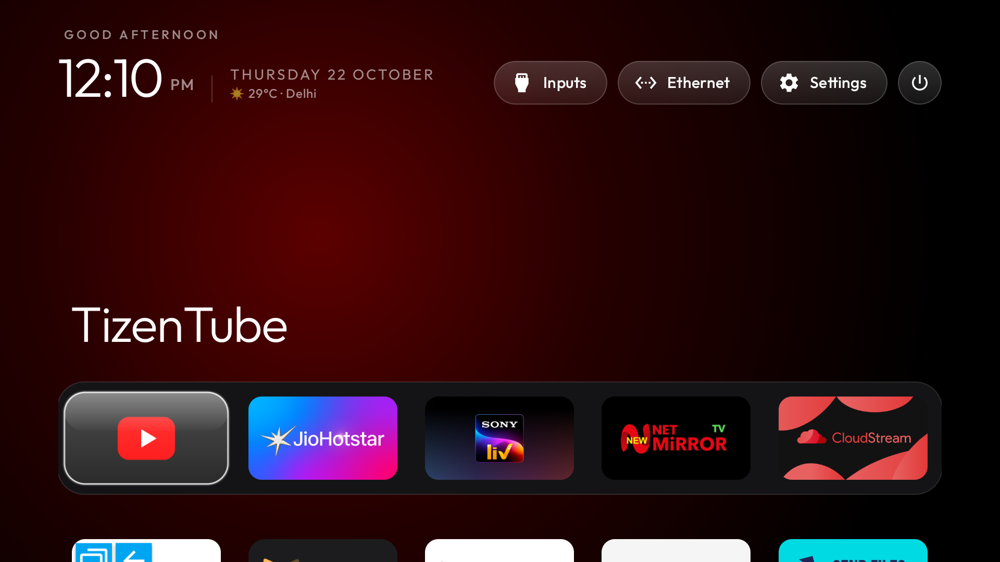
  <br>
  <em>Production verification screenshot: Free Your TV custom launcher verified on physical TV hardware (Motorola / KTC EcoTV Pro D, Android 11, October 22, 2026).<br>
  <strong>Note:</strong> Third-party streaming apps shown in the dock (such as TizenTube, JioHotstar, Button Mapper, and CloudStream) are user-installed apps and are not bundled with Free Your TV.</em>
</p>

---

## Before & After: Reclaiming Your Television

| Stock Google TV Interface (Illustrative Reference) | Free Your TV Final Production Interface |
| :---: | :---: |
|  |  |
| *Typical OEM Google TV interface cluttered with auto-playing video trailers, sponsored carousels, and manufacturer recommendation rows.*<br>*(**Note:** External illustrative reference; no ADB screenshot was captured from the test TV prior to custom launcher activation).* | *Free Your TV running on physical TV hardware. Pure OLED pitch-black background, custom Power button, RAM Cleaner pill, Live TV launcher, and customized dock.* |

---

## The Free Your TV Software Suite

Free Your TV is not merely an upstream project re-upload or a standalone launcher. It is an actively maintained, coordinated open-source software suite comprising three core Android applications:

| Application | Package Identifier | Source Directory | Architecture & Description |
|---|---|---|---|
| **Custom Launcher** | `com.freeyourtv.launcher` | [`launcher/app/`](launcher/app) | Native Java Leanback launcher with hardware-accelerated glass highlight, remote dock editor, 28 themes, festival greetings, TV inputs, weather, and power control. |
| **RAM Cleaner** | `com.freeyourtv.cleaner` | [`launcher/cleaner/`](launcher/cleaner) | Lightweight memory optimization tool designed for 1–2 GB RAM TVs with strict whitelist protection and honest memory delta reporting. |
| **Flutter Live TV** | `com.freeyourtv.livetv` | [`apps/live-tv/`](apps/live-tv) | Remote-optimized IPTV player featuring 441 baseline channels, multi-stream fallback, safe automatic catalogue updates, and custom M3U/M3U8 playlist management. |

---

## Free Viewing Alternatives: Cut the Cord & Stop Paying for Ads

Free Your TV empowers you to replace bloated, subscription-heavy, ad-saturated commercial services with lightweight, privacy-respecting alternatives:

<table width="100%">
  <thead>
    <tr>
      <th width="38%" align="center">BEFORE (Commercial Service)</th>
      <th width="6%" align="center"></th>
      <th width="38%" align="center">AFTER (Free Alternative)</th>
      <th width="18%" align="center">Status &amp; Architecture</th>
    </tr>
  </thead>
  <tbody>
    <!-- Row 1: YouTube -> SmartTube -->
    <tr>
      <td align="center">
        <br>
        <strong>YouTube for Android TV</strong><br>
        <sub>Unskippable pre-rolls, mid-roll ads, sponsored banners, and background video pause.</sub>
      </td>
      <td align="center" style="font-size: 20px;">➔</td>
      <td align="center">
        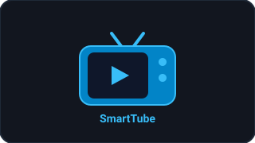<br>
        <strong>SmartTube</strong><br>
        <sub>Free &amp; open-source, built-in SponsorBlock, ad-free playback, up to 4K 60fps HDR, background audio, zero Google tracking.</sub>
      </td>
      <td align="left">
        <strong>Category:</strong> Independent App<br>
        <strong>Installer:</strong> <span style="color:#d29922">Planned / Sideload</span><br>
        <strong>Licence:</strong> GPL-3.0
      </td>
    </tr>
    <!-- Row 2: Netflix -> CloudStream -->
    <tr>
      <td align="center">
        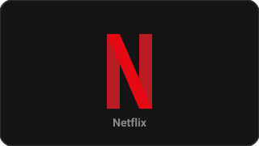<br>
        <strong>Netflix</strong><br>
        <sub>Recurring monthly subscription fees, password-sharing crackdowns, DRM lock-in, and tier-limited resolutions.</sub>
      </td>
      <td align="center" style="font-size: 20px;">➔</td>
      <td align="center">
        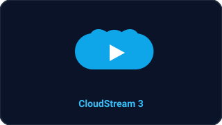<br>
        <strong>CloudStream 3</strong><br>
        <sub>Free &amp; open-source modular media streaming framework with community extensions, multilingual subtitles, and remote-friendly UI.</sub>
      </td>
      <td align="left">
        <strong>Category:</strong> Independent App<br>
        <strong>Installer:</strong> <span style="color:#d29922">Planned / Sideload</span><br>
        <strong>Licence:</strong> GPL-3.0
      </td>
    </tr>
    <!-- Row 3: Prime Video -> NetMirror -->
    <tr>
      <td align="center">
        <br>
        <strong>Prime Video</strong><br>
        <sub>Paid subscription with embedded commercial ads, additional rental paywalls, and regional catalog lockouts.</sub>
      </td>
      <td align="center" style="font-size: 20px;">➔</td>
      <td align="center">
        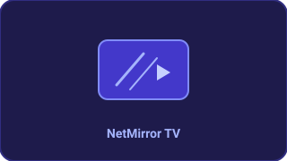<br>
        <strong>NetMirror TV</strong><br>
        <sub>Independent third-party media aggregator indexed for Android TV D-pad navigation with multiple server stream mirrors.</sub>
      </td>
      <td align="left">
        <strong>Category:</strong> Independent App<br>
        <strong>Installer:</strong> <span style="color:#d29922">Planned / Sideload</span><br>
        <strong>Package:</strong> <code>app.netmirror.newtv</code>
      </td>
    </tr>
    <!-- Row 4: Cable TV / DTH -> Free Your TV Live TV -->
    <tr>
      <td align="center">
        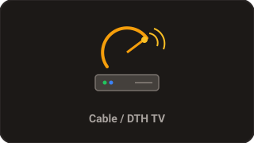<br>
        <strong>Cable / DTH Set-Top Box</strong><br>
        <sub>Recurring satellite packs, proprietary set-top box hardware, extra remote controls, and expensive per-channel tiers.</sub>
      </td>
      <td align="center" style="font-size: 20px;">➔</td>
      <td align="center">
        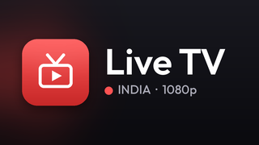<br>
        <strong>Free Your TV Live TV</strong><br>
        <sub><strong>Built-in 441-channel Pan-Indian catalogue</strong> across 10 categories, 45 fallback stream mappings, safe auto-updates, and custom M3U playlist manager.</sub>
      </td>
      <td align="left">
        <strong>Category:</strong> Built-In Suite<br>
        <strong>Installer:</strong> <span style="color:#238636">Implemented (Built-in)</span><br>
        <strong>Package:</strong> <code>com.freeyourtv.livetv</code>
      </td>
    </tr>
  </tbody>
</table>

### Install Only What You Choose

Free Your TV respects user autonomy: **we never silently install, bundle, or download third-party applications without explicit user review and approval.**

#### Current Installer Verification & Scope
A static source audit of the repository installer tools confirms the exact state of deployment today:
1. **Free Your TV Launcher (`com.freeyourtv.launcher`):** Built and installed via [`launcher/build-and-install.ps1`](launcher/build-and-install.ps1) and [`launcher/build-and-install.sh`](launcher/build-and-install.sh). The script verifies connection, builds the release APK, uploads via `b64push.py`, installs via `pm install -r`, sets default home, and prompts to enable optional accessibility services. If installation fails, the stock launcher is immediately preserved/restored.
2. **RAM Cleaner (`com.freeyourtv.cleaner`):** Built locally via `./gradlew :cleaner:assembleRelease` and installed via standard `adb install`.
3. **Flutter Live TV (`com.freeyourtv.livetv`):** Built locally via `flutter build apk` and installed via standard `adb install`. It includes a built-in 441-channel catalogue and custom M3U playlist import capabilities.
4. **Third-Party Viewing Alternatives (SmartTube, CloudStream, NetMirror):**
   - **Current Status:** **Planned / Installer not yet available.**
   - Automated download-and-install scripts for third-party APKs are currently in development and are **not yet bundled** in the repository.
   - Users who choose to use these alternatives install them independently via standard Android sideloading (ADB, USB drive, Send Files to TV, or Downloader).
   - **No Silent Uninstallation:** Installing Free Your TV or applying debloat profiles **never** uninstalls YouTube, Netflix, Prime Video, or any other commercial streaming app. Debloating is strictly an explicit user action that only *disables* packages for user 0 (`pm disable-user --user 0`), which can be fully reverted at any time using [`tools/restore.sh`](tools/restore.sh) or [`tools/restore.ps1`](tools/restore.ps1).
   - **Failure Isolation:** If an optional third-party app fails to install, crashes, or is uninstalled by the user, the Free Your TV launcher, RAM cleaner, and system operation remain completely unaffected.

> [!NOTE]
> ### Product Boundaries & Honest Disclaimers
> To maintain complete transparency, Free Your TV upholds strict architectural distinctions:
> - **Free Your TV Launcher:** Our custom-engineered Leanback launcher (`com.freeyourtv.launcher`), providing the home screen, on-TV remote dock editor, 28 themes, luminous festival greetings, weather, and power controls.
> - **Debloating:** Reversible ADB scripts (`tools/disable.*` and `tools/restore.*`) to disable preinstalled manufacturer bloatware and telemetry packages without deleting system files.
> - **Free Viewing Alternatives:** Independent, third-party open-source applications (such as SmartTube and CloudStream) that users may independently choose to sideload. Free Your TV does not develop, bundle, or officially endorse these applications.
> - **Free Your TV Live TV:** Our built-in Flutter IPTV player (`com.freeyourtv.livetv`), featuring a curated 441-channel Pan-Indian catalogue across 10 categories, 45 fallback stream mappings, automatic safe catalogue refreshes, and custom M3U/M3U8 playlist management.
>
> **Disclaimers:**
> - Free Your TV does not promise that every commercial paid subscription can be completely replaced, that third-party streams will remain permanently available, or that third-party streaming providers will remain operational.
> - All third-party trademarks, logos, and service names (YouTube, Netflix, Prime Video, etc.) are the property of their respective owners and are referenced strictly for identification and comparison under fair use. Their mention does not imply affiliation, sponsorship, or endorsement.

---

## Core Applications & Feature Highlights

### 1. Custom Launcher (`com.freeyourtv.launcher`)

Built natively in Java for minimal memory footprint and instant D-pad response:

- **Ad-Free Leanback Interface:** Replaces OEM promotional carousels, sponsored banners, and recommendation rows with a clean, distraction-free home screen. *(Note: "Ad-free" applies strictly to the Free Your TV launcher and its own interfaces; it does not remove advertisements delivered inside third-party streaming applications).*
- **OLED Dark Surface & Dynamic Ambient Glow:** Pitch-black background with dynamic ambient backlighting on the top shelf that automatically samples and reflects the dominant colors of the focused app.
- **Hardware-Accelerated Glass Highlight ([`GlassView`](launcher/app/src/main/java/com/freeyourtv/launcher/GlassView.java)):** Translucent floating glass slab with specular rim lighting and fluid spring physics (AndroidX `DynamicAnimation`) that glides between tiles without CPU redraw bottlenecks.
- **Icon-Only Power Button & Dialog Control:** Located at the top right of the home screen. On click, it triggers Android's native system power dialog (`GLOBAL_ACTION_POWER_DIALOG` with Lockdown, Power off, Restart) via [`HomeKeyService`](launcher/app/src/main/java/com/freeyourtv/launcher/HomeKeyService.java) (Accessibility Service). If the accessibility service is not yet enabled, it gracefully guides the user to Android Settings.
- **Customizable Dock Sizing (4, 5, or 6 Apps):** Supports user-selected dock bar sizes. The grid layout manager ([`GridLayoutManager`](launcher/app/src/main/java/com/freeyourtv/launcher/MainActivity.java)), card dimensions, and dock band decoration ([`DockDecoration`](launcher/app/src/main/java/com/freeyourtv/launcher/DockDecoration.java)) dynamically recalculate spans and persist preferences.
- **Interactive Dock & Grid Arrangement Editor:** Long-pressing any app card or pressing the remote **Menu** button opens an on-screen context menu:
  - *Dock apps:* Move Left, Move Right, Remove from Dock.
  - *Grid apps:* Add to Dock, Move Left, Move Right, Move Up, Move Down.
  - Direct access to Android App Info for any installed application.
  - Custom arrangements persist reliably in `SharedPreferences` (`favourites` and `gridOrder`).
- **28 Built-In Themes & Dedicated Festival Wallpapers:**
  - *Standard Themes:* OLED Pitch Black (`dark`), Clean Day (`light`), Gradient (`aurora`), and Custom wallpaper.
  - *24 Dedicated Festival Themes:* Hand-crafted vector wallpapers and themed color palettes for Diwali, Holi, Republic Day, Independence Day, Makar Sankranti/Pongal, Maha Shivratri, Ugadi, Ram Navami, Mahavir Jayanti, Baisakhi, Buddha Purnima, Rath Yatra, Raksha Bandhan, Krishna Janmashtami, Ganesh Chaturthi, Onam, Navratri, Dussehra, Karwa Chauth, Govardhan Puja, Bhai Dooj, Chhath Puja, Guru Nanak Jayanti, and Christmas. *(Note: Gregorian New Year is not implemented; regional New Year themes such as Ugadi and Baisakhi are supported).*
- **72-Festival Calendar & Luminous English Greetings:** Built-in multi-year Pan-Indian festival calendar automatically activates matching festival themes on festival dates. Displays a luminous English greeting banner (e.g. *"Happy Diwali"*, *"Happy Holi"*, *"Happy Republic Day"*) with warm gold luminance (`#FFFFDF7A`), aura shadow effects, and entrance animations.
- **Live Weather Integration ([`WeatherManager`](launcher/app/src/main/java/com/freeyourtv/launcher/WeatherManager.java)):** Free weather using the Open-Meteo public API (no API keys required, zero analytics tracking based on static source audit). Includes 30+ preconfigured Indian and global cities with automatic caching and Celsius/Fahrenheit toggle.
- **TV Inputs Menu:** Instant switching between HDMI 1–4, AV, and TV Tuner inputs via Android's native `TvInputManager`.
- **Status Indicators & Network Tracking:** Real-time Wi-Fi connectivity and automatic VPN indicator ([`VpnBadge`](launcher/app/src/main/java/com/freeyourtv/launcher/VpnBadge.java)) tracking Android network callbacks.
- **OLED Burn-In Protection Screensaver ([`ClockDream`](launcher/app/src/main/java/com/freeyourtv/launcher/ClockDream.java)):** Built-in drifting clock screensaver (`DreamService`) prevents image retention on OLED and plasma panels.

---

### 2. RAM Cleaner (`com.freeyourtv.cleaner`)

Smart TVs frequently suffer from aggressive memory bloat caused by background streaming services. The Free Your TV RAM Cleaner lives in [`launcher/cleaner/`](launcher/cleaner) and provides genuine optimization without gimmicks:

- **Strict Whitelist Safety:** Never terminates the custom launcher (`com.freeyourtv.launcher`), Button Mapper (`flar2.homebutton`), Google Play Services, active keyboard/input methods, or core system framework daemons.
- **Honest Memory Reporting:** Calculates genuine available RAM before and after cleanup via `ActivityManager.MemoryInfo`. If background memory is already reclaimed, it reports *"RAM Already Optimal"* rather than fabricating inflated numbers.
- **Non-Intrusive Workflow:** One-click execution with a clean circular progress indicator, automatically dismissing back to the launcher 1.8 seconds after displaying results.

---

### 3. Flutter Live TV (`com.freeyourtv.livetv`)

The Live TV player is built using Flutter for smooth remote navigation on TV screens:

- **441 Baseline Channels Across 10 Categories:** Sports (200), News (94), Entertainment (45), Movies (28), Devotional (24), Music (16), Infotainment (13), Other (11), Business (6), and Kids (4).
- **Multi-Stream Fallbacks:** Bundles 45 fallback channel stream mappings for continuous playback if a primary stream fails.
- **Safe Automatic Catalogue Updates:**
  - Automated upstream ingestion from community IPTV streams with a 24-hour refresh interval check.
  - Wire-level safety guards: Strict 10 MB streaming response limit prevents out-of-memory crashes on low-end TVs; 15-second total timeout covers connection handshake and full body transfer.
  - Pre-disk structural validation: Verifies minimum channel count (≥ 441), valid categories, non-empty stream URLs, and fallback integrity before touching storage.
  - Atomic persistence (`.tmp` write and flush before rename) ensures cache files cannot be corrupted by sudden TV power-offs.
  - **Fallback Preservation Guarantee:** When an upstream primary stream URL changes, the previous working primary is preserved as Fallback #1, ensuring no working streams are silently discarded.
  - Remote-accessible **Refresh Channels** button in the sidebar for manual on-demand updates.
- **Custom M3U/M3U8 Playlist Management:**
  - Dedicated **Manage Playlists** interface designed for TV remote navigation.
  - Add remote M3U/M3U8 playlist URLs with custom display names.
  - Enable or disable playlists selectively without deleting them.
  - On-demand refresh of user playlists.
  - User playlist data is stored in isolated files (`playlists.json`), completely untouched by built-in catalogue updates.

---

## Live TV Disclaimer & Content Rights

> [!IMPORTANT]
> **Free Your TV is an open-source media player software suite and does not host, stream, broadcast, or re-encode media content.**
>
> 1. **Third-Party Public Streams:** Built-in channel indexing parses publicly accessible M3U playlist URLs aggregated from upstream community sources. Free Your TV does not operate streaming servers or Content Delivery Networks (CDNs).
> 2. **No Availability or Authorization Guarantee:** The availability, resolution, server uptime, geographic compatibility, and broadcast authorization of third-party streams are outside the control of Free Your TV. Streams may experience buffering, geoblocking, or discontinuation by their origin hosts without notice.
> 3. **User-Managed Playlists:** Users importing custom M3U or M3U8 playlists are solely responsible for ensuring they possess the necessary rights, licences, and authorization to access their configured streams.
> 4. **Trademarks & Copyrights:** Free Your TV does not claim ownership of or copyright in any third-party logos, channel names, or broadcast streams accessed through the player.

---

## Curated Screenshot Gallery

The visual interface across all three applications has been documented through physical hardware captures and automated QA verification:

### 1. Launcher & System Controls
| Final Home Screen (OLED Black) | Native Android TV Power Menu |
| :---: | :---: |
| [](docs/screenshots/launcher/final-home-oled.png) | [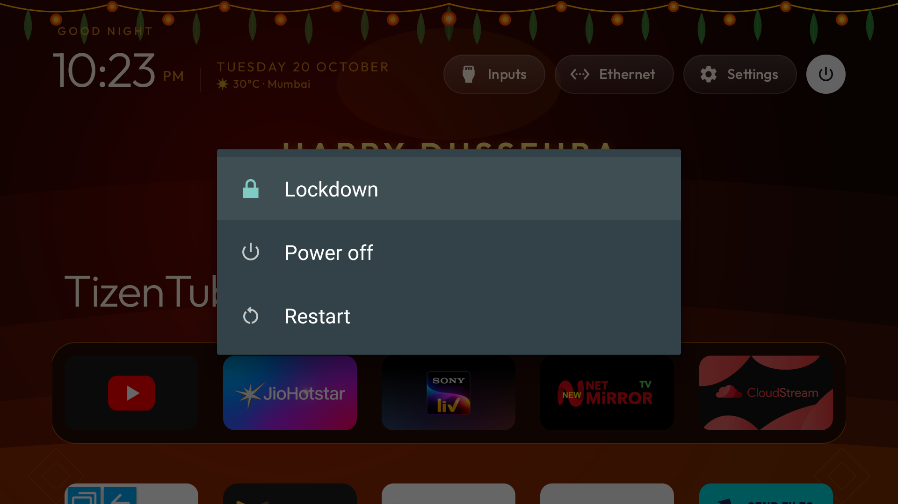](docs/screenshots/launcher/native-power-dialog.png) |
| *Final home screen showing top status pills (Power, Cleaner, Live TV, Wi-Fi, Inputs, Clock).* | *Native system power dialog showing Lockdown, Power off, and Restart.* |

| Dock Context Menu | App Grid Context Menu | Settings Popup Menu |
| :---: | :---: | :---: |
| [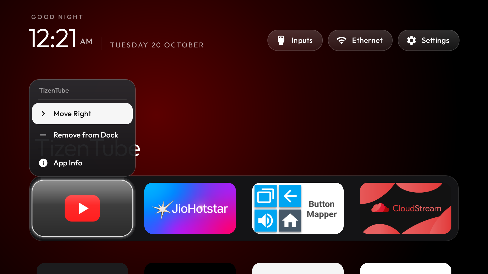](docs/screenshots/launcher/dock-context-menu.png) | [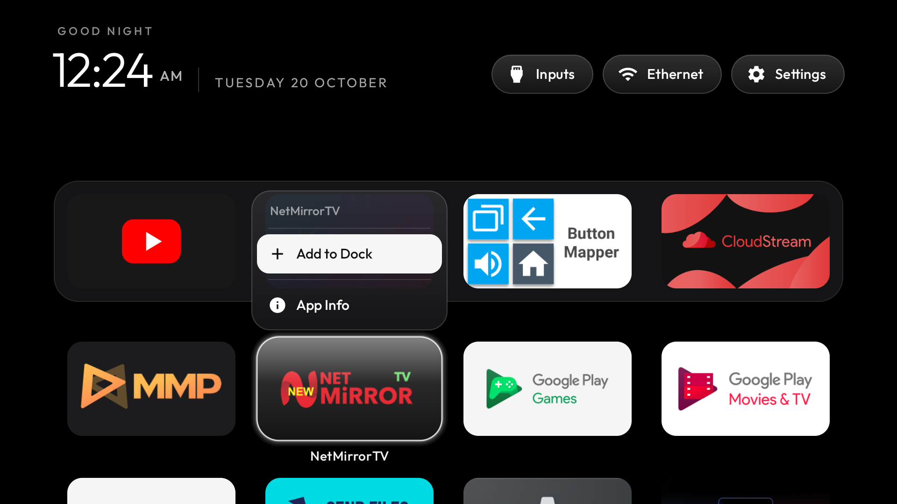](docs/screenshots/launcher/app-grid-context-menu.png) | [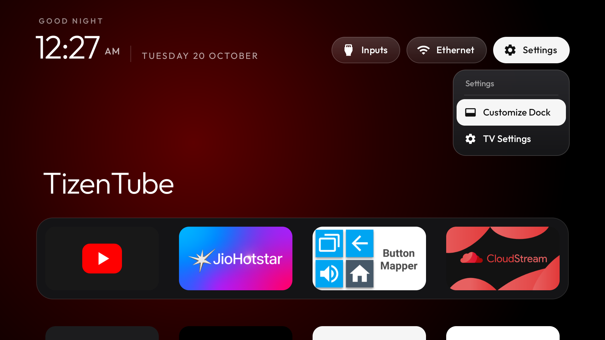](docs/screenshots/launcher/settings-popup-menu.png) |
| *Long-press OK to Move Left, Move Right, or Remove from Dock.* | *Slide-up app grid menu to add apps to dock or reorder.* | *Settings dropdown providing dock configuration and TV system settings.* |

### 2. Festival Themes & Luminous Greetings
| Republic Day (Production Capture) | Dussehra (Live Hardware Capture) |
| :---: | :---: |
| [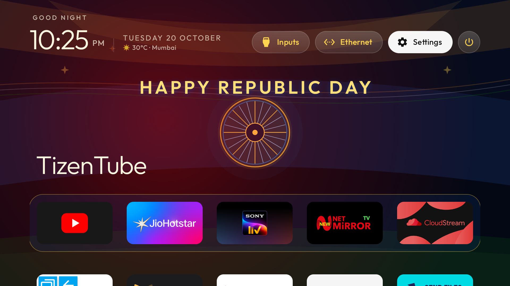](docs/screenshots/themes/festival-republic-day.png) | [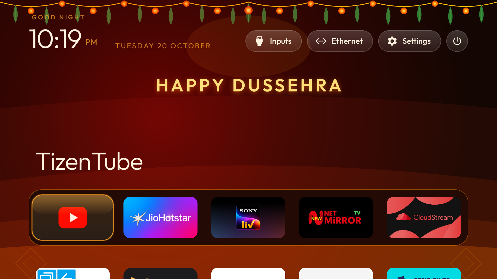](docs/screenshots/themes/festival-dussehra-live.png) |
| *Republic Day theme with tricolor vector background and luminous greeting banner.* | *Dussehra theme captured live on physical TV hardware on Dussehra (20 October 2026).* |

| Diwali (Date-Simulation Capture) | Christmas (Date-Simulation Capture) |
| :---: | :---: |
| [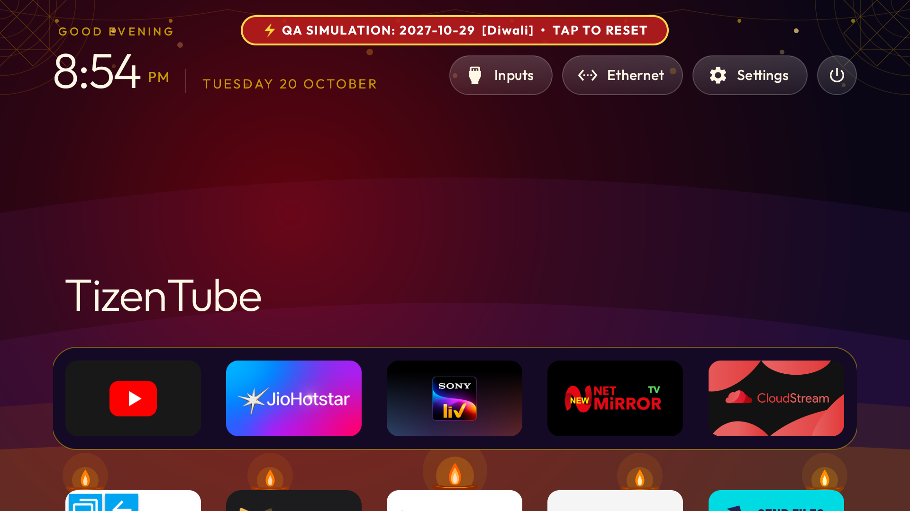](docs/screenshots/themes/festival-diwali-simulated.png) | [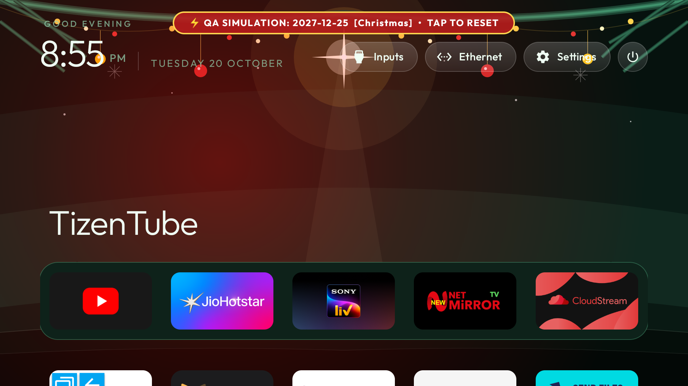](docs/screenshots/themes/festival-christmas-simulated.png) |
| *Diwali theme with diya vector art (historical QA date simulation capture with banner).* | *Christmas theme with festive pine vector art (historical QA date simulation capture with banner).* |

### 3. Live Weather Integration
| Delhi Weather on Home | Weather Settings Menu | City Selector Dialog |
| :---: | :---: | :---: |
| [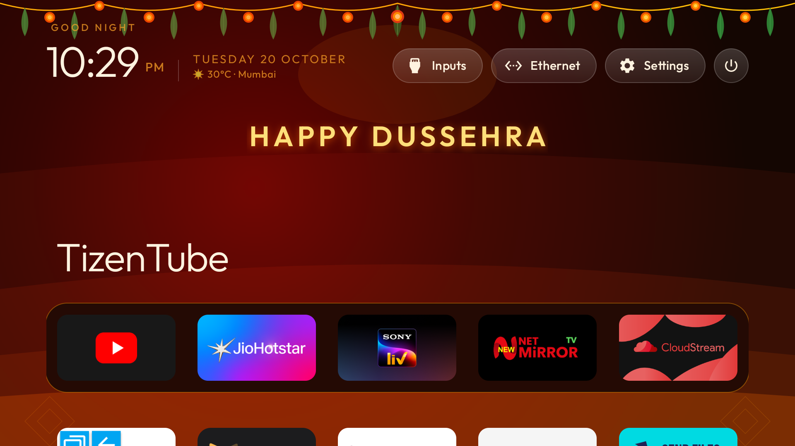](docs/screenshots/weather/weather-delhi-home.png) | [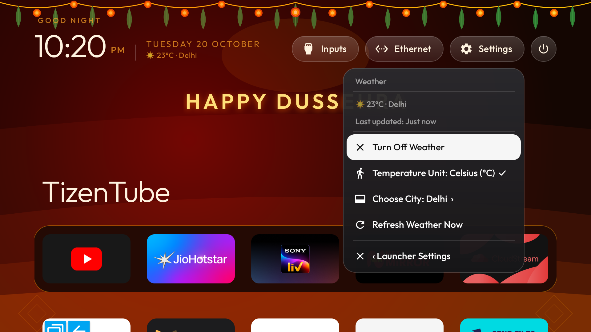](docs/screenshots/weather/weather-settings.png) | [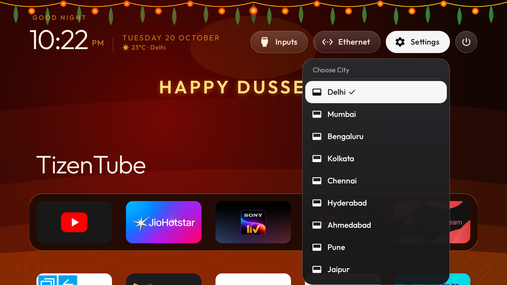](docs/screenshots/weather/weather-city-picker.png) |
| *Real-time temperature and condition display.* | *Weather configuration screen for city and unit.* | *Preconfigured Indian and global cities selector.* |

### 4. RAM Cleaner & Flutter Live TV
| RAM Cleaner Result Dialog | Live TV Category Guide (News) | Live Stream Playback (Aaj Tak HD) |
| :---: | :---: | :---: |
| [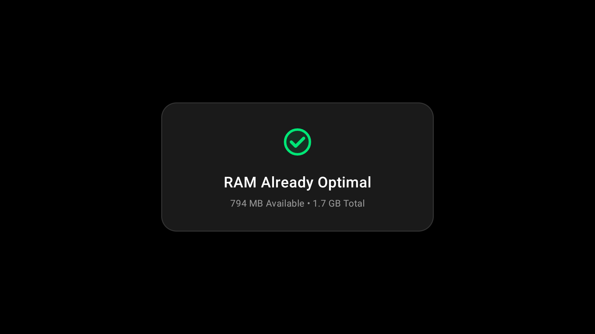](docs/screenshots/cleaner/cleaner-result.png) | [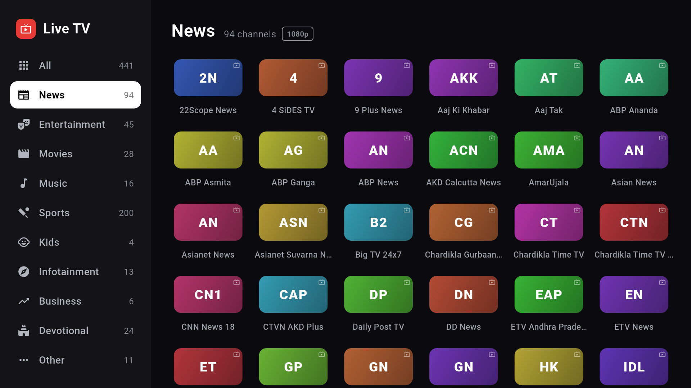](docs/screenshots/livetv/livetv-channel-guide.png) | [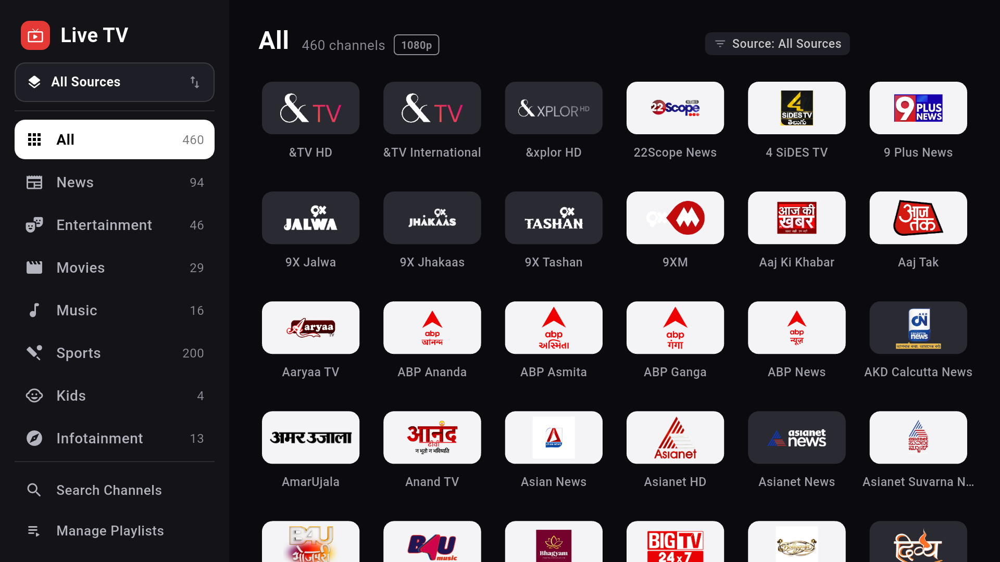](docs/screenshots/livetv/livetv-playback.png) |
| *Honest memory delta reporting actual MB freed.* | *441-channel electronic programme and category guide.* | *Hardware-accelerated live stream playback.* |

👉 **[Explore the Complete 27-Screenshot Gallery & SHA-256 Checksums](docs/screenshots/README.md)**

---

## Hardware Evidence vs. QA Simulation & Known Gaps

> [!NOTE]
> **Hardware Verification Environment:**
> - **Test Device:** Motorola / KTC EcoTV Pro D (`hongkong`), Android 11 (API 30), 1080p Full HD (`1920x1080`).
> - **Testing Dates:** October 19–22, 2026.
> - **Physical Hardware Captures:** Final Home OLED (`screen_final_home.png`), Power Dialog (`test_settings_main.png`), Dussehra Theme (`live_home_after_install.png`), Cleaner Result (`screen_cleaner_result.png`), Live TV Guide & Playback (`screen_cat_news.png`, `screen_playback_aajtak.png`), and Playlist Management (`screen_manage_playlists.png`).
> - **QA Date-Simulation Captures:** Diwali and Christmas screenshots were captured during automated multi-year calendar validation by overriding the system clock. They include an on-screen simulation banner to distinguish them from clean real-date production captures.

> [!WARNING]
> **Known Screenshot Evidence Gaps:**
> - **Pre-Install Stock TV Screen:** As established in Phase 7H, no ADB screencap was taken before custom launcher activation on the test TV. The stock Google TV image is an external illustrative reference.
> - **Light/White Theme (`light`):** Supported in code; lacks historical screenshot evidence.
> - **Aurora Gradient Theme (`aurora`):** Supported in code; lacks historical screenshot evidence.
> - **Custom Wallpaper Picker:** Supported in code; lacks historical screenshot evidence.
> - **6-App Dock Bar & Dock-Size Picker UI:** Supported in code; lacks historical screenshot evidence.
> - **Gregorian New Year:** Not implemented in source code; no screenshot exists.
> *These variants are actively awaiting fresh capture in future hardware testing sessions.*

---

## Prerequisites & Build Guide

### Environment Prerequisites

| Tool | Minimum Version | Required By |
|---|---|---|
| **Java Development Kit (JDK)** | JDK 17 (OpenJDK 17 or Android Studio JBR) | Launcher, RAM Cleaner, Live TV runner |
| **Android SDK** | Compile SDK 34, Build-Tools 34.0.0 | Launcher, RAM Cleaner |
| **Flutter SDK** | Flutter 3.2.1+ (Dart `>=3.2.1 <4.0.0`) | Flutter Live TV |
| **Python** | Python 3.8+ (with `venv` module) | `tools/tv.py` and debloat tools |

---

### Building the Custom Launcher (`com.freeyourtv.launcher`)

```bash
cd launcher
./gradlew :app:assembleRelease
```
*Output APK:* `launcher/app/build/outputs/apk/release/app-release-unsigned.apk`

---

### Building the RAM Cleaner (`com.freeyourtv.cleaner`)

```bash
cd launcher
./gradlew :cleaner:assembleRelease
```
*Output APK:* `launcher/cleaner/build/outputs/apk/release/cleaner-release-unsigned.apk`

---

### Building Flutter Live TV (`com.freeyourtv.livetv`)

```bash
cd apps/live-tv
flutter build apk --release --target-platform android-arm --android-skip-build-dependency-validation
```
*(For 64-bit Android TV devices, specify `--target-platform android-arm64`.)*
*Output APK:* `apps/live-tv/build/app/outputs/flutter-apk/app-release.apk`

---

### Verified Offline Test Execution

All three applications include comprehensive unit test suites verified to pass completely offline without network access:

```bash
# 1. Launcher unit tests (20 tasks)
cd launcher
./gradlew :app:testDebugUnitTest --offline

# 2. RAM Cleaner unit tests (20 tasks)
./gradlew :cleaner:testDebugUnitTest --offline

# 3. Flutter Live TV unit and widget tests (34 tests)
cd ../apps/live-tv
flutter test --no-pub
```

---

## Planned Integrations & Optional Tools

- **Button Mapper ([`flar2.homebutton`](https://play.google.com/store/apps/details?id=flar2.homebutton)):** Recommended optional third-party utility. On Android TV devices where OEM firmware restricts third-party launchers, Button Mapper allows you to remap the remote Home key to open `com.freeyourtv.launcher` or launch Live TV directly with a double-tap.
- **External Video Players & Streaming Apps:** The Free Your TV launcher organizes and launches all installed streaming apps (Netflix, Prime Video, YouTube, Hotstar, etc.).
- **Future Integration Hooks (Planned):**
  - *SmartTube / YouTube:* Planned launcher top-shelf shortcut and direct deep-linking hooks. *(Not currently bundled or integrated in source code).*
  - *NetMirror:* Planned streaming shortcut integration for supported media services. *(Not currently bundled or integrated in source code).*

---

## Supported Hardware & Debloating Guide

Free Your TV works on any television, streaming stick, or set-top box running **Android TV** or **Google TV** (Xiaomi, Redmi, TCL, Hisense, Sony, OnePlus, Realme, Nvidia Shield, Motorola, and others).

*Note: Samsung (Tizen) and LG (webOS) run proprietary non-Android operating systems and are not compatible. Amazon Fire TV (Fire OS) supports debloating only.*

### Applying Debloat Profiles Over Wi-Fi

Debloating uses reversible Android package manager commands (`pm disable-user --user 0`) to disable manufacturer ad rows and telemetry packages without deleting system files:

1. **Enable Developer Options on TV:**
   - Navigate to **Settings → Device Preferences → About**.
   - Press **OK** on **Build** seven times until developer mode is unlocked.
   - Go to **Developer Options** and turn on **USB debugging**.
2. **Apply Profile via Standalone Python Tools:**
   ```bash
   python3 -m venv tools/venv && tools/venv/bin/pip install -r tools/requirements.txt
   export TV_HOST=192.168.1.50   # Replace with your TV IP address

   # Probe device
   tools/venv/bin/python -I tools/tv.py --probe

   # Apply debloat profile (e.g. Xiaomi Mi TV 4A)
   tools/disable.sh examples/xiaomi-mi-tv-4a/debloat.txt
   ```

Pre-tested debloat profiles are provided in [`examples/`](examples/) for over 15 popular TV models.

### Restoring Your TV

To revert debloating and restore the factory launcher:

```bash
# Android TV
TV_HOST=192.168.1.50 tools/restore.sh examples/<your-tv>/debloat.txt

# Google TV
TV_HOST=192.168.1.50 tools/restore.sh examples/<your-tv>/debloat.txt com.google.android.apps.tv.launcherx
```

> [!NOTE]
> **Restore Script Behavior:**
> The restore script re-enables all disabled system packages listed in the profile (`pm enable`) and restores the default home resolver. It cannot recover third-party application data cleared by the user or restore changes outside the scope of the package profile.

---

## Current Limitations & Roadmap

### Known Limitations
- **DRM-Protected Content:** The Live TV player supports public, unencrypted HLS (`m3u8`) streams. Encrypted DRM streams (Widevine L1/L3) cannot be played.
- **Accessibility Service for Power Menu:** Android TV security restricts third-party apps from invoking global system dialogs. Triggering the native power dialog via the top-right power button requires enabling the Free Your TV Accessibility Service in TV Settings.
- **Platform Compatibility:** Exclusively supports Android TV / Google TV. Non-Android smart TV platforms (Tizen, webOS) are unsupported.

### Project Roadmap
- [ ] User-customized wallpaper image importing via local storage or USB.
- [ ] Folder and category grouping for app grid tiles.
- [ ] Quick-access remote shortcuts for user-specified media utilities.
- [ ] EPG (Electronic Program Guide) timeline view for Live TV.

---

## Attribution, Lineage & Licensing

Free Your TV combines original engineering, extensive customization, and respected upstream open-source foundations:

### Free Your TV Project & Modifications
- **Project Maintainer:** [matureakshay](https://github.com/matureakshay)
- **Original Modifications & Engineering:**
  - Unified package namespace migration to `com.freeyourtv.*`.
  - Development of the standalone RAM Cleaner module ([`launcher/cleaner/`](launcher/cleaner)) with whitelist protection.
  - Launcher dock size customization (4, 5, or 6 apps) with dynamic span recalculation.
  - Interactive D-pad dock and grid reordering context menu with persistent state.
  - Icon-only power button integrated with [`HomeKeyService`](launcher/app/src/main/java/com/freeyourtv/launcher/HomeKeyService.java) Accessibility Service.
  - 28-theme engine with 24 dedicated Indian festival vector wallpapers, multi-year festival calendar, and luminous greeting banner.
  - Open-Meteo live weather manager with 30+ preconfigured cities.
  - Safe automatic Live TV catalogue updater with wire limits, atomic persistence, and fallback preservation.
  - User-managed custom M3U/M3U8 playlist management interface in Flutter Live TV.

### Upstream Foundations & Licences
- **Launcher Core:** Derived from the open-source `tv-vibehack` launcher created by [Gathin](https://x.com/gathint) under the [MIT Licence](LICENSE).
- **Typography:** The [Outfit](https://fonts.google.com/specimen/Outfit) typeface by The Outfit Project Authors is licensed under the [SIL Open Font License 1.1](launcher/FONT-LICENSE-OFL.txt).
- **Live TV Player:** Derived from the `tv/master` branch of [`kananinirav/Indian-IPTV-App`](https://github.com/kananinirav/Indian-IPTV-App) by Kanani Nirav under the [MIT Licence](apps/live-tv/LICENSE).
- **Channel Indexing Metadata:** Public channel catalogue metadata utilizes data from [`iptv-org/iptv`](https://github.com/iptv-org/iptv) (Public Domain / The Unlicense).
