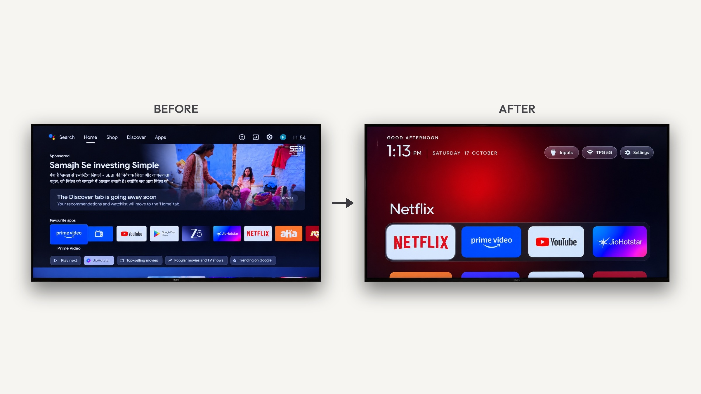
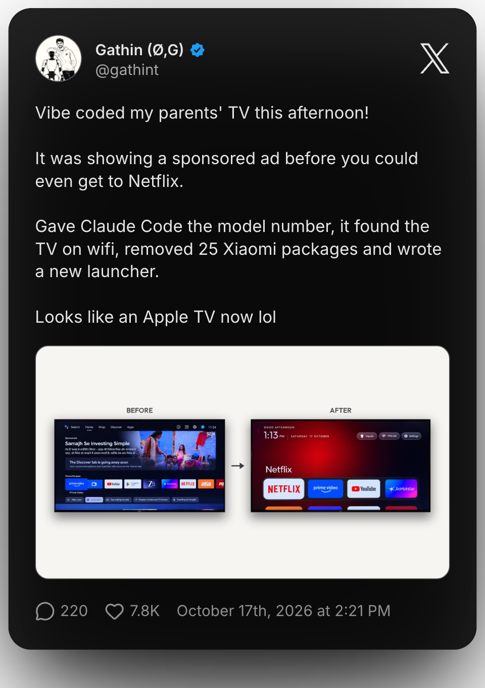

# Free Your TV

**Your TV, minus the ads.**

Free Your TV is a clean, open-source software suite and debloating guide for Android TV and Google TV. It replaces ad-filled home screens, manufacturer telemetry, and sluggish interfaces with a fast, privacy-respecting setup inspired by Apple TV.

**No root, no cables, nothing irreversibly uninstalled, and a one-line restore if you change your mind.**



---

## The Free Your TV Suite

Free Your TV includes three core Android applications designed specifically for low-memory smart TVs (sets with 1 GB to 2 GB of RAM):

| Application | Package Identifier | Source Path | Description |
|---|---|---|---|
| **Custom Launcher** | `com.freeyourtv.launcher` | [`launcher/app/`](launcher/app) | Native Java Leanback launcher with glass selection effects, ambient tile glow, dock bar, TV inputs menu, and weather/clock. |
| **RAM Cleaner** | `com.freeyourtv.cleaner` | [`launcher/cleaner/`](launcher/cleaner) | One-click memory optimization tool that reclaims background process RAM while strictly protecting system services, the launcher, and Button Mapper. |
| **Live TV** | `com.freeyourtv.livetv` | [`apps/live-tv/`](apps/live-tv) | Lightweight Flutter IPTV player for 1080p channels with automatic multi-stream fallback and custom user-managed M3U/M3U8 playlist support. |

---

## Historical Origins and Attribution

Free Your TV originated from the open-source **tv-vibehack** project by Gathin, created to debloat an ad-laden family Mi TV over Wi-Fi using Claude Code. The project's lineage and upstream components are preserved and credited:

- **Launcher Core:** Derived from the original `tv-vibehack` launcher created by [Gathin](https://x.com/gathint) (see the [historical tweet](https://x.com/gathint/status/2111379569030939102)). Licensed under the [MIT Licence](LICENSE).
- **Typography:** The [Outfit](https://fonts.google.com/specimen/Outfit) typeface by The Outfit Project Authors is licensed under the [SIL Open Font License 1.1](launcher/FONT-LICENSE-OFL.txt).
- **Live TV Player:** Derived from the `tv/master` branch of [`kananinirav/Indian-IPTV-App`](https://github.com/kananinirav/Indian-IPTV-App) by Kanani Nirav, licensed under the [MIT Licence](apps/live-tv/LICENSE).
- **Channel Indexing & Logos:** Built-in channel indexing utilizes public metadata from [`iptv-org/iptv`](https://github.com/iptv-org/iptv) (The Unlicense / Public Domain).

<p align="center">
  <a href="https://x.com/gathint/status/2111379569030939102"></a>
  <br>
  <em>Historical context: The initial tv-vibehack experiment that inspired Free Your TV.</em>
</p>

---

## Table of Contents

- [How It Works](#how-it-works)
- [Quick Start](#quick-start)
- [Core Applications](#core-applications)
  - [1. Custom Launcher](#1-custom-launcher)
  - [2. RAM Cleaner](#2-ram-cleaner)
  - [3. Flutter Live TV](#3-flutter-live-tv)
- [Live TV Disclaimer & Content Rights](#live-tv-disclaimer--content-rights)
- [Prerequisites & Build Guide](#prerequisites--build-guide)
- [Supported TVs](#supported-tvs)
- [Doing It by Hand (Debloat & Tools)](#doing-it-by-hand-debloat--tools)
- [Restoring Your TV](#restoring-your-tv)
- [Upgrading and Device Recovery](#upgrading-and-device-recovery)
- [Verified Offline Testing](#verified-offline-testing)
- [Troubleshooting](#troubleshooting)
- [Frequently Asked Questions](#frequently-asked-questions)
- [Contributing](#contributing)
- [Licence](#licence)

---

## How It Works

Android TVs feature the same Android Debug Bridge (ADB) as Android smartphones. Once USB debugging is enabled in Developer Options, the TV listens over Wi-Fi and prompts you once to authorize your computer. After that, standard Android commands handle everything:

1. **Back up** the TV's installed package inventory and system settings.
2. **Disable** manufacturer telemetry, ad rows, recommendation feeds, and preloaded bloatware via `pm disable-user`. Nothing is deleted from system partitions, so a restore script can reverse every modification.
3. **Install** the lightweight native launcher, cleaner, and Live TV player.

---

## Quick Start

You need a computer connected to the same local network as the TV, and either a terminal or an AI coding assistant with shell capabilities (such as Claude Code):

1. **On the TV:**
   - Go to **Settings → Device Preferences → About**.
   - Press **OK** on **Build** seven times until developer mode is unlocked.
   - Go back to **Developer Options** and turn on **USB debugging** (and **Network / Wireless debugging** if present). Keep the TV awake.
2. **On your computer:**
   - Paste the debloating prompt from [`PROMPT.md`](PROMPT.md) into your assistant and provide your TV model.
3. **Follow along:**
   - Accept the "Allow USB debugging?" prompt on the TV screen.
   - Confirm which streaming apps you use and which four apps belong in your dock.
   - The assistant backs up packages, applies the debloat list, builds and installs the launcher, and validates the configuration.

---

## Core Applications

### 1. Custom Launcher

- **Package ID:** `com.freeyourtv.launcher`
- **Location:** [`launcher/app/`](launcher/app)
- **Features:**
  - Pitch-black OLED background with a frosted dock row at the bottom for four favorite apps.
  - Top shelf displaying focused application titles with dynamic ambient glow matched to app artwork.
  - Slide-up grid for remaining applications on pressing D-pad Down.
  - Floating translucent glass highlight with spring animations (AndroidX DynamicAnimation).
  - Quick-access buttons for Inputs (HDMI/AV/Tuner dropdown), Wi-Fi status, and Settings.
  - Indian festival themes and greetings powered by `FestivalThemeEngine`.
  - Configurable in [`launcher/app/src/main/res/values/config.xml`](launcher/app/src/main/res/values/config.xml).
  - Optional drifting Clock Screensaver (`ClockDream`) to prevent burn-in.

### 2. RAM Cleaner

- **Package ID:** `com.freeyourtv.cleaner`
- **Location:** [`launcher/cleaner/`](launcher/cleaner)
- **Features:**
  - One-click automatic background process memory optimization.
  - Non-misleading reporting: calculates genuine memory deltas before and after cleanup, reporting "RAM Already Optimal" if no cached memory was freed.
  - Strict whitelist safety: never terminates `com.freeyourtv.launcher`, `flar2.homebutton` (Button Mapper), Google Play Services, input methods, or core system framework daemons.
  - Auto-closes and returns to the home launcher 1.8 seconds after displaying results.

### 3. Flutter Live TV

- **Package ID:** `com.freeyourtv.livetv`
- **Location:** [`apps/live-tv/`](apps/live-tv)
- **Features:**
  - Leanback remote-optimized UI with categorized sidebar navigation.
  - 1080p stream filtering with automatic fallback switching across 45 channels with multi-stream alternatives.
  - **Custom M3U/M3U8 Playlist Support:** Users can import remote playlist URLs, name them, refresh them on demand, enable or disable playlists selectively, and delete them.
  - Persistent playlist storage with offline caching so channels open instantly on startup.

---

## Live TV Disclaimer & Content Rights

> [!IMPORTANT]
> **Free Your TV is an open-source media player and does not host, stream, re-encode, or broadcast any media content.**

1. **Third-Party Streams:** Built-in channel indexing parses publicly accessible M3U playlist URLs aggregated from upstream community sources. Free Your TV does not operate streaming servers or Content Delivery Networks (CDNs).
2. **No Availability Guarantee:** The availability, resolution, server uptime, and geographic compatibility of third-party streams are outside the control of Free Your TV. Streams may experience buffering, geoblocking, or discontinuation by their respective origin hosts without notice.
3. **User-Managed Playlists:** Users who import custom M3U or M3U8 playlists are solely responsible for ensuring they possess the necessary rights, licences, and authorization to access their configured streams.
4. **Content Rights:** Free Your TV does not claim ownership of or copyright in any third-party logos, channel trademarks, or broadcast media accessed through the player.

---

## Prerequisites & Build Guide

### Required Prerequisites

| Requirement | Minimum Version | Used By |
|---|---|---|
| **Java Development Kit (JDK)** | JDK 17 (e.g. OpenJDK 17 or Android Studio JBR) | Launcher, RAM Cleaner, Live TV runner |
| **Android SDK** | Compile SDK 34, Build-Tools 34.0.0 | Launcher, RAM Cleaner |
| **Flutter SDK** | Flutter 3.2.1+ (Dart SDK `>=3.2.1 <4.0.0`) | Flutter Live TV |
| **Python** | Python 3.8+ (with `venv` module) | `tools/tv.py` and debloat scripts |

### Building and Installing the Launcher

**On Windows (PowerShell):**
```powershell
powershell -ExecutionPolicy Bypass -File launcher\build-and-install.ps1 -TvHost 192.168.1.50
```

**On Linux / macOS (Bash):**
```bash
TV_HOST=192.168.1.50 launcher/build-and-install.sh
```

### Building and Installing the RAM Cleaner

```bash
cd launcher
./gradlew :cleaner:assembleRelease
# Install over ADB
python3 ../tools/tv.py --push cleaner/build/outputs/apk/release/cleaner-release.apk /data/local/tmp/cleaner.apk
python3 ../tools/tv.py 'pm install -r /data/local/tmp/cleaner.apk; rm /data/local/tmp/cleaner.apk'
```

### Building and Installing Flutter Live TV

```bash
cd apps/live-tv
flutter build apk --release --target-platform android-arm --android-skip-build-dependency-validation
# Install over ADB
python3 ../../tools/tv.py --push build/app/outputs/flutter-apk/app-release.apk /data/local/tmp/livetv.apk
python3 ../../tools/tv.py 'pm install -r /data/local/tmp/livetv.apk; rm /data/local/tmp/livetv.apk'
```
*(For 64-bit TVs, specify `--target-platform android-arm64`.)*

---

## Supported TVs

Free Your TV works on any television or streaming box running **Android TV** or **Google TV**: Xiaomi, Redmi, TCL, Hisense, Sony, OnePlus, Realme, Nvidia Shield, and others.

Samsung (Tizen) and LG (webOS) run non-Android operating systems and are not compatible. Amazon Fire TV (Fire OS) supports debloating only, as Fire OS prevents third-party launchers from replacing the default home activity.

Pre-tested debloat profiles are available in [`examples/`](examples/):

| Model | OS |
|---|---|
| BenQ E55-735 (Changhong AI PONT, DVB96BQ) | Google TV 14 |
| CHiQ AI PONT (DVB93CQ) | Android TV 11 |
| Hisense SmartTV 4K FFM (huangshan, MediaTek) | Android TV 10 |
| Insignia 55" F30 4K Fire TV (NS-55F301NA25, AFTDCT31, duckie) | Fire OS 7 / Android 9 |
| NVIDIA SHIELD TV Pro 2019 (P2897, mdarcy) | Android TV 11 |
| OnePlus TV (D00, Dubai) | Google TV 14 |
| RCA AI PONT SA (Changhong, redwood, ISDB92RC) | Android 14 |
| SANYO ATV R2 (SCBC, Realtek RTD285O) | Android TV 9 |
| Sony BRAVIA 4K UR2 (BRAVIA_UR2_4K, MediaTek) | Android TV 10 |
| Sony BRAVIA XBR-65X900E (2017, BRAVIA_ATV2) | Android TV 9 |
| TCL 55" 4K Google TV, 2023 (G10, G10_4K_US_NF) | Google TV 12 |
| TCL 65C725 (Smart TV Pro, BeyondTV4) | Android TV 11 |
| TCL BeyondTV (India) | Android TV 9 |
| TCL QM6K Pro, 2025 (G08, MediaTek tcl9618) | Google TV 14 |
| Xiaomi Mi Box S (MIBOX4, oneday), streaming box | Android TV 9 |
| Xiaomi Mi TV (MiTV-MOOQ0, croods) | Android TV 10 |
| Xiaomi Mi TV 4A (MiTV-MOOQ1) | Android TV 10 |
| Xiaomi MiTV-AESP0 stick (aquaman, 1 GB) | Android TV 9 |
| Xiaomi MiTV-AXSO0 (dangal; Mi TV 4C Pro 2019 / 4A Pro) | Android TV 9 |
| Xiaomi MiTV-MOOR2 (venom, MediaTek) | Google TV 11 |
| Xiaomi TV A Pro 75" 2026 (MiTV-MZTU0, river, MediaTek) | Google TV 14 |

---

## Doing It by Hand (Debloat & Tools)

Every action performed by the assistant can be executed directly using the standalone Python tools:

```bash
python3 -m venv tools/venv && tools/venv/bin/pip install -r tools/requirements.txt
export TV_HOST=192.168.1.50                                   # your TV's IP address

tools/venv/bin/python -I tools/tv.py --probe                 # model, Android version, firmware
tools/venv/bin/python -I tools/tv.py 'pm list packages'      # run a shell command on the TV
tools/disable.sh examples/xiaomi-mi-tv-4a/debloat.txt        # apply a debloat list
tools/restore.sh examples/xiaomi-mi-tv-4a/debloat.txt        # undo debloat and restore stock launcher
```

### Windows PowerShell

```powershell
python -m venv tools\venv; tools\venv\Scripts\python.exe -m pip install -r tools\requirements.txt
powershell -ExecutionPolicy Bypass -File launcher\build-and-install.ps1 -TvHost 192.168.1.50
powershell -ExecutionPolicy Bypass -File tools\disable.ps1 -TvHost 192.168.1.50 examples\xiaomi-mi-tv-4a\debloat.txt
powershell -ExecutionPolicy Bypass -File tools\restore.ps1 -TvHost 192.168.1.50 examples\xiaomi-mi-tv-4a\debloat.txt
```

---

## Restoring Your TV

To revert modifications and restore the stock TV launcher:

```bash
TV_HOST=192.168.1.50 tools/restore.sh examples/<your tv>/debloat.txt                 # Android TV
TV_HOST=192.168.1.50 tools/restore.sh examples/<your tv>/debloat.txt com.google.android.apps.tv.launcherx   # Google TV
```

The restore script re-enables all disabled packages in your debloat list, re-enables the stock launcher, restores the default home role, and resets UI animation scales.

---

## Upgrading and Device Recovery

- **Package Migration:** Free Your TV applications use the unified namespace `com.freeyourtv.*`. If an older installation of `com.gathin.tvhome` exists on the TV, Android treats `com.freeyourtv.launcher` as a separate application and both will coexist.
- **Button Mapper Configuration:** If you use Button Mapper (`flar2.homebutton`) or a remote key remapping service, ensure the Home button is configured to launch `com.freeyourtv.launcher`.
- **Default Home Role:** On some Android TV firmware, assigning the default home activity requires manual confirmation. If pressing the remote Home button prompts you to select a launcher, choose **Free Your TV** and select **Always**.
- **Accessibility Permissions:** If using optional input key features (`-InputKeyService` or `-HomeKeyService`), verify under TV Settings → Device Preferences → Accessibility that the Free Your TV service is enabled.

---

## Verified Offline Testing

All core application test suites are verified to run completely offline without network dependencies:

```bash
# 1. Launcher unit tests
cd launcher
./gradlew :app:testDebugUnitTest --offline

# 2. RAM Cleaner unit tests
./gradlew :cleaner:testDebugUnitTest --offline

# 3. Flutter Live TV unit and widget tests
cd ../apps/live-tv
flutter test --no-pub
```

---

## Troubleshooting

- **macOS Local Network Privacy:** `adb connect` may report "No route to host" even when the port is open because macOS Local Network privacy blocks the Google `adb` binary. `tools/tv.py` connects via pure Python sockets, bypassing this issue.
- **Setup Wizard Intercepting Home:** On certain Google TV firmware (e.g. Xiaomi MiTV-MOOR2), `com.google.android.tungsten.setupwraith` answers the HOME intent at higher priority. Disabling `setupwraith` frees the Home slot. Re-enable it before performing a factory reset.
- **USB Power Cut:** Some streaming boxes (like the Xiaomi Mi Box S) switch their USB port into ADB peripheral mode when USB debugging is enabled, cutting power to connected USB drives. Disable USB debugging once setup is complete.
- **Screenshots Blank:** Screenshots taken while HDMI or Live TV video overlays are playing may return empty frames due to DRM/hardware plane overlays. Return to the home screen before running `screencap`.

---

## Frequently Asked Questions

**Is this safe? Can it brick my TV?**  
Nothing is written to boot partitions or system ROMs. All debloating is performed via `pm disable-user`, which affects only the user space profile and can be reversed at any time from TV Settings or via `tools/restore.sh`.

**Do streaming apps still update?**  
Yes. Netflix, Prime Video, YouTube, Hotstar, and the Google Play Store remain enabled and update normally.

**Can I download prebuilt APKs?**  
Free Your TV does not publish prebuilt binaries. Building from source ensures transparency, security, and exact control over what runs on your hardware.

---

## Contributing

Debloat profiles for additional TV models are warmly welcomed. See [CONTRIBUTING.md](CONTRIBUTING.md) for contribution guidelines and testing practices.

---

## Licence

- Free Your TV is licensed under the [MIT Licence](LICENSE) (Copyright (c) 2026 Gathin).
- Live TV module derived from Kanani Nirav's work under the [MIT Licence](apps/live-tv/LICENSE).
- Outfit font software is licensed under the [SIL Open Font License 1.1](launcher/FONT-LICENSE-OFL.txt).
