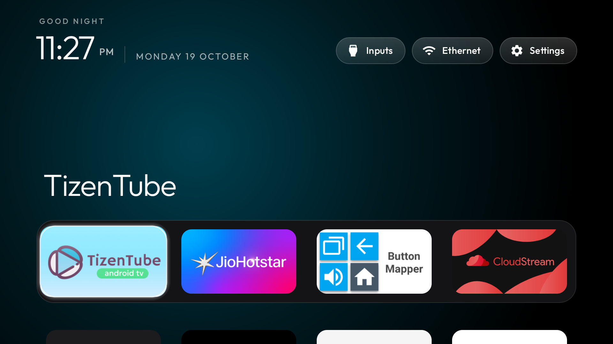
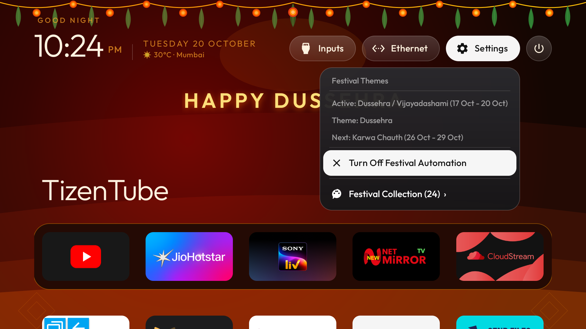
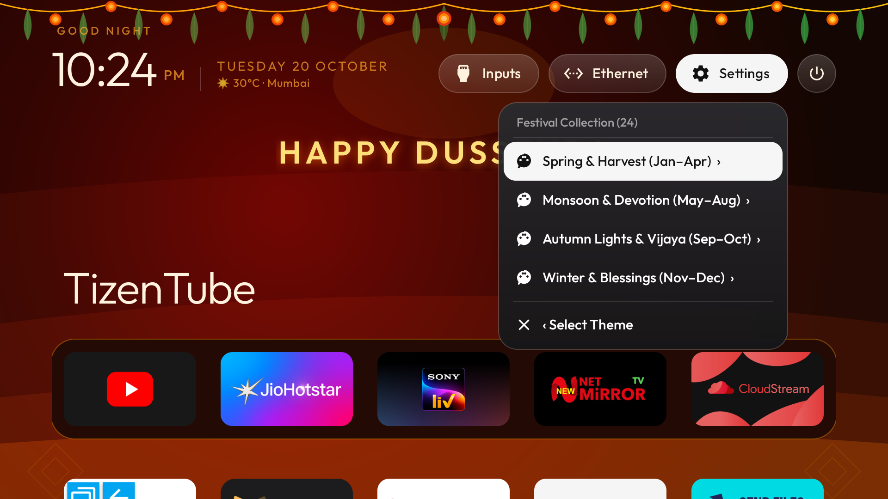
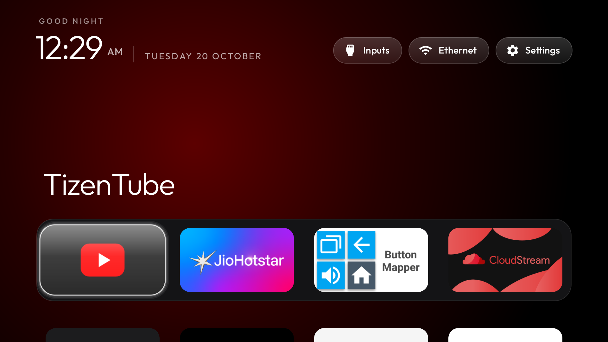
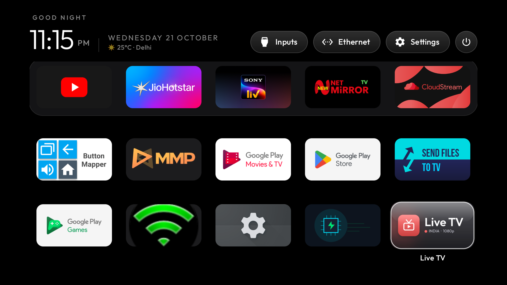
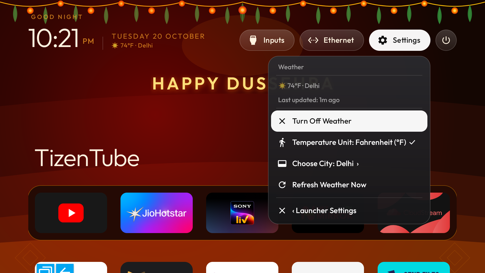
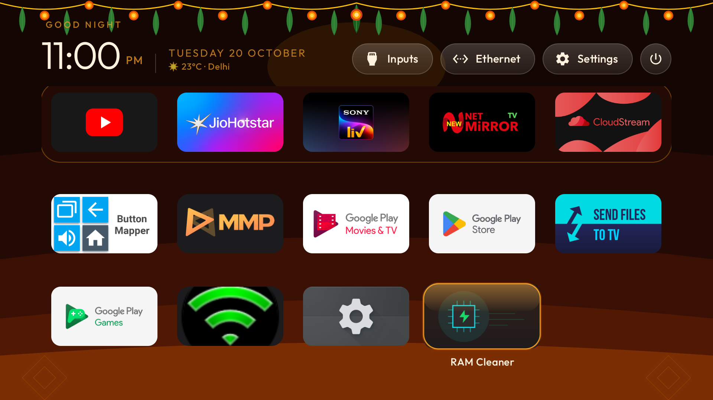
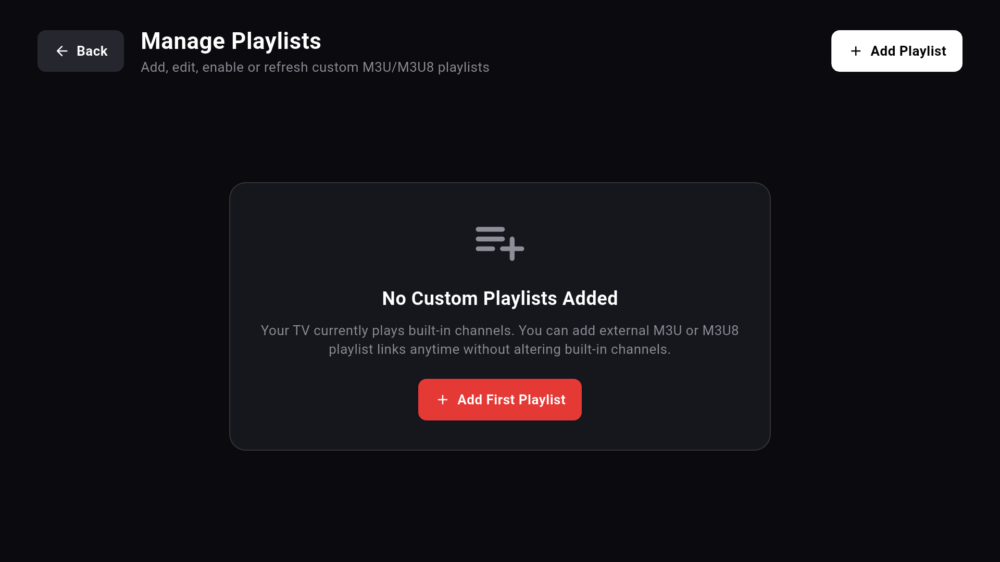
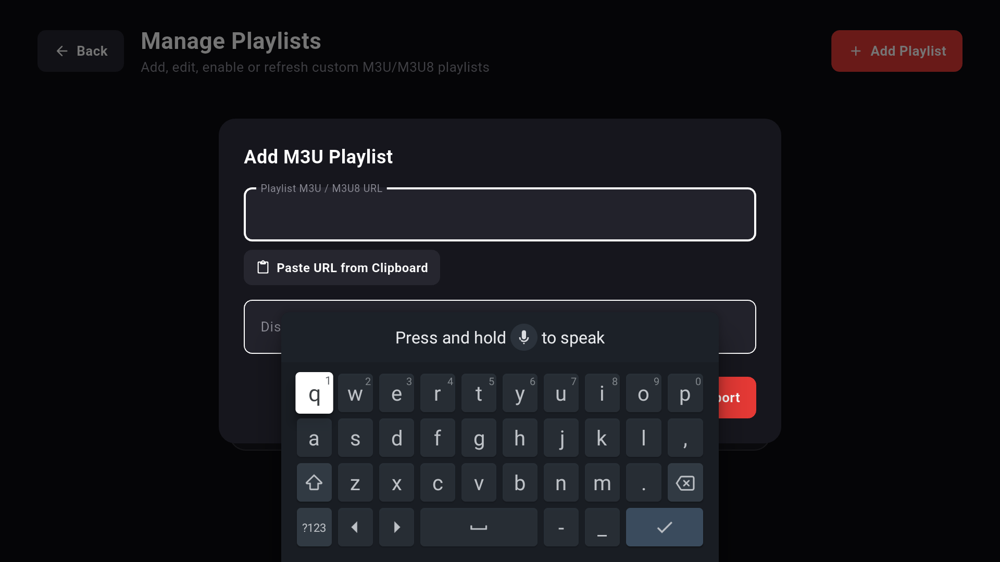
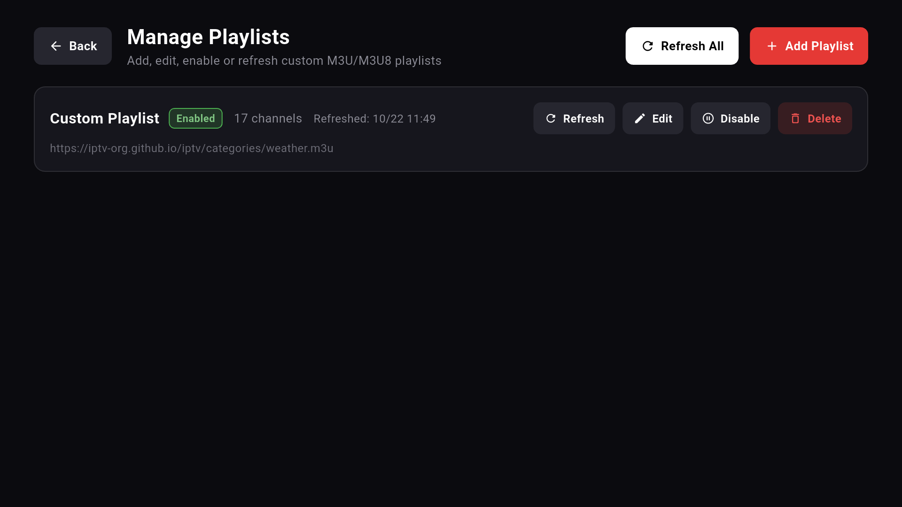

# Free Your TV — Screenshot Gallery & Hardware Evidence

This gallery documents the visual interface of the **Free Your TV** software suite across all three applications:
- **Custom Launcher** (`com.freeyourtv.launcher`)
- **RAM Cleaner** (`com.freeyourtv.cleaner`)
- **Flutter Live TV** (`com.freeyourtv.livetv`)

---

## Hardware Verification & Capture Provenance

> [!NOTE]
> **Physical Test Environment:**
> - **Device:** Motorola / KTC EcoTV Pro D (`hongkong`), Android 11 (API level 30)
> - **Display Resolution:** 1080p Full HD (`1920x1080`)
> - **Capture Method:** Hardware-accelerated frame capture via ADB (`screencap -p`) over TCP
> - **Testing Dates:** October 19–22, 2026

> [!IMPORTANT]
> **Third-Party Application Notice:**
> Third-party applications visible in certain hardware verification screenshots (such as *TizenTube*, *JioHotstar*, *CloudStream*, *Button Mapper*, and *NetMirrorTV*) were pre-existing user-installed applications present on the physical TV during testing. **They are not bundled, redistributed, or developed by Free Your TV.**

---

## 1. Before & After Comparison

| Comparison | Image | Description |
| :--- | :---: | :--- |
| **Before (Illustrative Reference)** |  | **Illustrative Google TV Reference:** Upstream reference image showing typical OEM Google TV interface with sponsored banners and promotional content rows. *Note: As established in Phase 7H, no ADB screenshot was captured from the test TV prior to custom launcher activation; this image is an external reference illustration.* |
| **Before (Earliest Physical Capture)** |  | **Earliest Physical TV Capture (19 Oct 2026 23:27 IST):** First screenshot taken on the physical TV, captured 52 seconds after setting `com.gathin.tvhome` as default home. Shows the unmodified baseline launcher with default teal glow before feature development. |
| **After (Final Free Your TV Production)** |  | **Final Production Free Your TV (22 Oct 2026 12:10 IST):** Verified on physical TV hardware. Pitch-black OLED background, custom Power button, RAM Cleaner pill, Live TV quick pill, customized dock, and digital clock/date header. |

---

## 2. Custom Launcher & System Controls

### 2.1 Final Home Screen & System Power Dialog
The launcher replaces vendor bloat with an instant-response Leanback interface. Clicking the top-left **Power** button triggers Android's native TV power menu (`GLOBAL_ACTION_POWER_DIALOG`) via accessibility services.

| Final Home Screen (OLED Black) | Native Android TV Power Menu |
| :---: | :---: |
|  |  |
| *Final home screen showing top status pills (Power, Cleaner, Live TV, Wi-Fi, Inputs, Clock).* | *Native system power dialog showing Lockdown, Power off, and Restart.* |

### 2.2 On-TV Remote Dock & Grid Editor
Users can customize their dock bar and app grid directly from the TV remote using long-press or the Menu key:

| Dock Context Menu | App Grid Context Menu | Settings Popup Menu |
| :---: | :---: | :---: |
|  |  |  |
| *Long-press OK on any dock item to Move Left, Move Right, or Remove from Dock.* | *Long-press OK on any grid app to Add to Dock or reorder in the grid.* | *Settings dropdown providing direct access to launcher options and TV system settings.* |

---

## 3. Themes & Dedicated Festival Wallpapers

Free Your TV includes a built-in theme engine featuring standard OLED Black, Clean Day, and 24 dedicated Pan-Indian festival themes with vector artwork and warm gold luminous English greeting banners (`#FFFFDF7A`).

### 3.1 Production Festival Captures

| Republic Day (Genuine Capture) | Dussehra (Live Production Hardware Capture) |
| :---: | :---: |
|  |  |
| *Republic Day theme with tricolor vector background and "Happy Republic Day" greeting.* | *Dussehra theme captured live on the physical TV during Dussehra (20 October 2026).* |

### 3.2 Historical QA Date-Simulation Captures
> [!NOTE]
> The screenshots below were captured during automated multi-year calendar validation. The dates were simulated via system clock override to verify vector rendering, color schemes, and greeting banner typography.

| Diwali (Date-Simulation Capture) | Christmas (Date-Simulation Capture) |
| :---: | :---: |
|  |  |
| *Diwali theme with diya vector art, deep maroon palette, and luminous greeting banner.* | *Christmas theme with festive pine vector artwork and warm holiday greeting banner.* |

### 3.3 Theme Settings & Vector Wallpaper Gallery

| Festival Settings Menu | Festival Wallpaper Gallery |
| :---: | :---: |
|  |  |
| *Toggle festival themes on/off and configure greeting banner entrance animations.* | *Preview all 24 hand-crafted vector wallpapers from launcher settings.* |

> [!WARNING]
> **Known Screenshot Evidence Gaps (Themes):**
> - **Light/White Theme (`light`):** Supported in code; lacks historical screenshot evidence.
> - **Aurora Gradient Theme (`aurora`):** Supported in code; lacks historical screenshot evidence.
> - **Custom Wallpaper Picker:** Supported in code; lacks historical screenshot evidence.
> - **Gregorian New Year:** Not implemented in source code (no screenshot exists). Regional New Year themes (Ugadi, Baisakhi) are supported.
> *These missing variants are marked as awaiting fresh capture from future hardware sessions.*

---

## 4. Dock Configurations

The launcher dynamically recalculates spans, margins, and card bounds to support user-selected dock sizes:

| 4-App Dock Configuration | 5-App Dock Configuration |
| :---: | :---: |
|  |  |
| *4-app dock bar verified during early intermediate build testing.* | *5-app dock bar verified in final production build with Live TV.* |

> [!WARNING]
> **Known Screenshot Evidence Gaps (Dock):**
> - **6-App Dock Bar:** Supported in code; lacks historical screenshot evidence.
> - **Dock-Size Picker UI:** Supported in code; lacks historical screenshot evidence.

---

## 5. Live Weather Integration

The launcher integrates the Open-Meteo public API for real-time weather forecasts with zero telemetry tracking, no API keys, and automatic response caching:

| Home Weather Pill | Weather Settings Menu |
| :---: | :---: |
|  |  |
| *Real-time temperature and condition display on home screen (Delhi, 25°C).* | *Weather configuration screen for city selection and temperature unit.* |

| City Selector Dialog | Fahrenheit Unit Toggle |
| :---: | :---: |
|  |  |
| *City selector offering 30+ preconfigured Indian and global metropolitan cities.* | *Temperature unit toggled to Fahrenheit display.* |

---

## 6. RAM Cleaner (`com.freeyourtv.cleaner`)

Designed specifically for 1 GB to 2 GB RAM smart TVs, the RAM Cleaner terminates background cached processes while strictly whitelisting the launcher, Button Mapper, accessibility daemons, and system services.

| Memory Cleanup Result Dialog | RAM Cleaner Focused on Header |
| :---: | :---: |
|  |  |
| *Honest memory delta reporting actual MB freed, or "RAM Already Optimal" if no bloat.* | *RAM Cleaner status pill focused on the launcher top shelf for 1-click execution.* |

---

## 7. Flutter Live TV (`com.freeyourtv.livetv`)

The remote-optimized IPTV player features a built-in 441-channel Pan-Indian catalogue across 10 categories, 45 fallback stream mappings, automatic safe catalogue refreshes, and full custom M3U/M3U8 playlist management.

### 7.1 Electronic Programme Guide & Live Playback

| 441-Channel Category Guide (News) | Live Stream Playback (Aaj Tak HD) |
| :---: | :---: |
|  |  |
| *D-pad optimized channel selector displaying channel numbers, logos, and categories.* | *Hardware-accelerated playback with on-screen channel information overlay.* |

### 7.2 Custom M3U/M3U8 Playlist Management

| Playlist Manager Interface | Add Custom Playlist Dialog | Loaded Playlists List |
| :---: | :---: | :---: |
|  |  |  |
| *Central hub for managing local and remote M3U/M3U8 playlist URLs.* | *Input dialog for entering custom playlist name and URL with keyboard support.* | *Active playlists list displaying total channel counts and sync status.* |

---

## 8. Complete Verified Screenshot Inventory

| # | Relative File Path | Dimensions | Size | Full SHA-256 Checksum | Capture Context |
| :---: | :--- | :---: | :---: | :--- | :--- |
| 1 | [`comparison/stock-reference-home.jpg`](comparison/stock-reference-home.jpg) | 1448 × 1086 | 480,097 B | `350fd8c60e88961839b42a47858f62413f3daf97c586ff3d23cf0d1b66f35c02` | Upstream template reference |
| 2 | [`comparison/free-your-tv-final-home.png`](comparison/free-your-tv-final-home.png) | 1920 × 1080 | 235,134 B | `0d42dc49ad708948ade4b3b3e436bbe16a84223175840d59a00f3a64dac4cf34` | Physical TV (EcoTV Pro D) |
| 3 | [`comparison/early-launcher-baseline.png`](comparison/early-launcher-baseline.png) | 1920 × 1080 | 329,087 B | `071a0d04fe98d94d5dc01f303457a740de9082b2804766adf6fb04b6e6566af7` | Physical TV (First capture) |
| 4 | [`launcher/final-home-oled.png`](launcher/final-home-oled.png) | 1920 × 1080 | 235,134 B | `0d42dc49ad708948ade4b3b3e436bbe16a84223175840d59a00f3a64dac4cf34` | Physical TV (Production home) |
| 5 | [`launcher/native-power-dialog.png`](launcher/native-power-dialog.png) | 1920 × 1080 | 226,685 B | `1f4fde21a6675bc98eb4b79148d4ee47bb48fb3c25b44fc9035105267198bb98` | Physical TV (Power menu) |
| 6 | [`launcher/dock-context-menu.png`](launcher/dock-context-menu.png) | 1920 × 1080 | 239,412 B | `71cb47a5fecb2ea0862024b172a159981be4246061c47094bdafa2f1c83c27ce` | Physical TV (Dock editor) |
| 7 | [`launcher/app-grid-context-menu.png`](launcher/app-grid-context-menu.png) | 1920 × 1080 | 208,982 B | `41fffd2b7ea49fd5df297782b09a72174304e2ffebf52233f81eec956be84bf8` | Physical TV (Grid editor) |
| 8 | [`launcher/settings-popup-menu.png`](launcher/settings-popup-menu.png) | 1920 × 1080 | 237,052 B | `3d5d396e3539d2a6ff73df2a7ba44717f93aa899436ca6d5c5cf14e76a6cf499` | Physical TV (Settings popup) |
| 9 | [`launcher/dock-four-apps.png`](launcher/dock-four-apps.png) | 1920 × 1080 | 232,634 B | `e5c80f680ce53ed427d14554a72f1fed466042188be08b6b5790a547da9ea91f` | Physical TV (4-app dock) |
| 10 | [`launcher/dock-five-apps.png`](launcher/dock-five-apps.png) | 1920 × 1080 | 322,675 B | `e185c8dcc814f9d0c67926f2f2e519e496a75f2ee3fecdc45e75da2ae956ea74` | Physical TV (5-app dock) |
| 11 | [`themes/festival-republic-day.png`](themes/festival-republic-day.png) | 1920 × 1080 | 406,240 B | `2a18e75d67faa116e001887e5971510d9fa7a9b033fa2688f3bdf906d9e0303e` | Genuine production capture |
| 12 | [`themes/festival-dussehra-live.png`](themes/festival-dussehra-live.png) | 1920 × 1080 | 332,228 B | `6a606f6e8b956c2eff04cd730a3d3e88c97303848e8957d859d7ab659e97f997` | Physical TV (Live Dussehra) |
| 13 | [`themes/festival-diwali-simulated.png`](themes/festival-diwali-simulated.png) | 1920 × 1080 | 318,888 B | `870a25d103ef25095d2433fca418b32ba36ec3b9a71a1795ea3bc815be776f28` | QA date-simulation |
| 14 | [`themes/festival-christmas-simulated.png`](themes/festival-christmas-simulated.png) | 1920 × 1080 | 359,779 B | `3490dd2240643ea4489aee7b40114003d65b141fb1c3a71b12b591b65bce5179` | QA date-simulation |
| 15 | [`themes/festival-settings-menu.png`](themes/festival-settings-menu.png) | 1920 × 1080 | 359,364 B | `634dfa08bfe4cc3c3be9fe53e6b2067e2a9b3ce57e3f4369be3c1fc850896068` | Genuine settings capture |
| 16 | [`themes/festival-gallery.png`](themes/festival-gallery.png) | 1920 × 1080 | 365,488 B | `e64c8e05be2f10bced47a2fb606117462a498bfe1b9d4791a27e7ca4579c3b88` | Genuine gallery capture |
| 17 | [`weather/weather-delhi-home.png`](weather/weather-delhi-home.png) | 1920 × 1080 | 332,967 B | `97b52893685862aa48d68962c0fc441028e35fa14972e2cf5c1b52b2f592750e` | Physical TV (Weather pill) |
| 18 | [`weather/weather-settings.png`](weather/weather-settings.png) | 1920 × 1080 | 355,162 B | `f1bca64c1585e9fa63690d57b545f09fb3cb2b7f32997b6ca40356bfce7e3e26` | Genuine settings capture |
| 19 | [`weather/weather-city-picker.png`](weather/weather-city-picker.png) | 1920 × 1080 | 334,840 B | `386f052c1de68dd343b2ae4c1533bf705c75bf6424b94f1c7908b9feff998632` | Genuine dialog capture |
| 20 | [`weather/weather-fahrenheit.png`](weather/weather-fahrenheit.png) | 1920 × 1080 | 344,317 B | `fc4a3244c648f8ef69e120f2b2c48ba42ca3a9e334df57662cf5a8a8167ffb43` | Genuine unit toggle |
| 21 | [`cleaner/cleaner-result.png`](cleaner/cleaner-result.png) | 1920 × 1080 | 36,445 B | `18388d121c80e6912384a6c2057d3862ca934f59fc91bf701e67cf1722e0394f` | Physical TV (Cleaner result) |
| 22 | [`cleaner/cleaner-home-focused.png`](cleaner/cleaner-home-focused.png) | 1920 × 1080 | 330,710 B | `e5e4f3ee4ca7c936df3146e2fcfa8fc4280ca7b69c47e819b52a0a2df3d1796d` | Physical TV (Cleaner focused) |
| 23 | [`livetv/livetv-channel-guide.png`](livetv/livetv-channel-guide.png) | 1920 × 1080 | 519,459 B | `d08877b7cd57b1c31278ffbc3ca308ea7e738ffeb6175f7ecb932d0c2ee5d7a0` | Physical TV (Live TV Guide) |
| 24 | [`livetv/livetv-playback.png`](livetv/livetv-playback.png) | 1920 × 1080 | 326,258 B | `55e43cfb21a7b5502c347d4e339bf4b26715fbcfa595462fffe16a9dd9a02ea0` | Physical TV (Live Playback) |
| 25 | [`livetv/livetv-manage-playlists.png`](livetv/livetv-manage-playlists.png) | 1920 × 1080 | 77,513 B | `596577c26f763522f6764491753cfa32ef3db6612f1bb1ff213567781b0a88a0` | Physical TV (Manage Playlists) |
| 26 | [`livetv/livetv-add-playlist.png`](livetv/livetv-add-playlist.png) | 1920 × 1080 | 107,677 B | `d1117f4b915d3c4ac413a94312ea1bc29b5c2d3346f0d7e63b1da329ceab15fc` | Physical TV (Add Playlist) |
| 27 | [`livetv/livetv-playlist-list.png`](livetv/livetv-playlist-list.png) | 1920 × 1080 | 75,021 B | `463e9a4d647ddac2cfd013ef12f67ff7e868f08c3ec04da56353d712217f2256` | Physical TV (Playlists list) |
